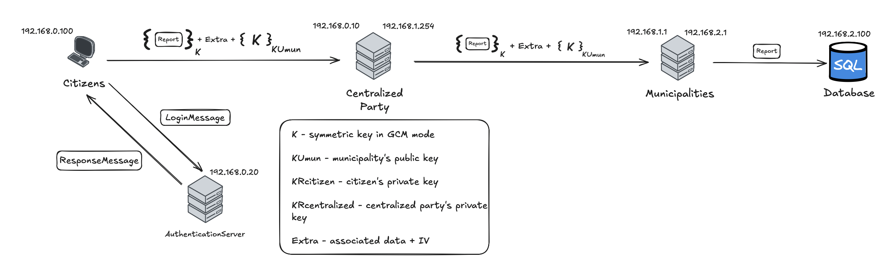
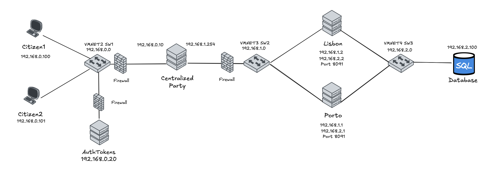
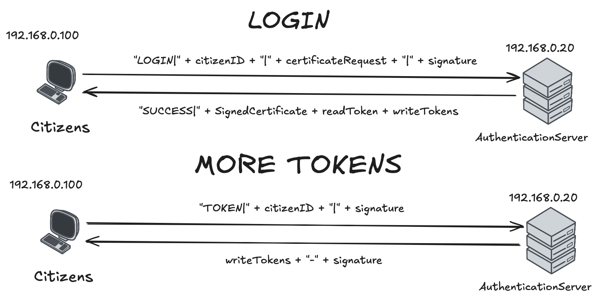

# A03 CivicEcho Project Report

## 1. Introduction
`CivicEcho` is a secure citizen reporting system designed to enable anonymous civic participation while maintaining report authenticity and integrity. The system addresses the critical challenge of allowing citizens to submit legitimate reports about civic issues to their municipalities while preserving their anonymity and preventing malicious actors from submitting false reports.

The system operates within a distributed network environment and consists of five primary entities: an Authentication Server, which authenticates citizens and issues tokens that allow them to submit reports, Citizens, who can create and read reports, a Centralized Party, which acts as a trusted intermediary responsible for token verification and request forwarding, Municipalities, which process and respond to these requests and a Database Server, which stores incoming reports and provides access to them.



### 1.1 Assumptions

1. The public keys from the municipalities, centralized party, authentication server and database are well known.
2. All private keys are private and are only accessed by the owner, although for simplicity they’re stored in the same directory.
3. The certificates from the municipalities, centralized party, authentication server and database are predistributed and signed by the   authentication server.
4. Valid citizens are already registered at the authentication server.
5. Citizens can only query reports from their municipality.
6. The Centralized Party, Authentication Server and Municipality perform all verifications correctly and cannot fail.
7. Due to the anonymity of the reports in the application context, citizens can't perform delete or update operations, only read and create.
8. All report related requests go through the Centralized Party before reaching Municipalities.

### 1.2 Requirements

1. Confidentiality: 
- Centralized Party can't have access to the report contents
- The distribution of certificates and tokens must be protected
2. Anonymity - Reports can't be traced back to their author
3. Integrity - Municipalities must verify that reports weren't altered
4. Authentication:
- Citizens must authenticate themselves through the Authentication Server before contacting the Centralized Party
- Centralized Party must verify the authenticity of the citizen's token
5. Freshness - Centralized Party must verify if the token has not been used before
6. Non-Repudiation - If a report is in the database then it must be valid

## 2. Project Development

### 2.1. Secure Document Format

#### 2.1.1. Design

Our cryptographic library secures citizen-generated reports in JSON format through four primary commands: protect, unprotect, check, ProtectSymmetric and UnprotectSymmetric. 
To ensure confidentiality, integrity, and authenticity, before a report enters the network, the citizen must first protect it. 
***
**Confidentiality:**

We employ a hybrid encryption scheme to protect the report efficiently. Since asymmetric encryption is inefficient for large messages, the process begins with the citizen generating a random unique symmetric key for AES in Galois Counter Mode (GCM), which provides `perfect future protection`. This key encrypts the report itself. The symmetric key is then encrypted using the public key of the intended municipality, ensuring that only the municipality with the corresponding private key can access it, thus guaranteeing `[R1: confidentiality] and [R2: anonymity]`.
***
**Integrity:**

The GCM mode inherently provides `[R3: integrity]`. Any tampering with the ciphertext, even a single bit, results in a completely different authentication tag, which the municipality can detect during decryption, causing the message to be rejected. 
***
**Read Operation:**

When a citizen wants to read other citizen’s reports, they protect this request in the same way as when they create a new report. The centralized party forwards this request to the citizen’s municipality. Upon receiving the request, the municipality unprotects, stores the session key and queries the database for the number of reports requested. To guarantee that only the citizen can see the contents, the municipality encrypts the response with the session key.
***
**Protected Document Format:**

The secure document format uses a JSON structure encoded in Base64:
```
  {
    "ciphered": "base64_encrypted_content",
    "iv": "base64_initialization_vector",
    "aad": {
      "timestamp": "report_timestamp",
      "location": "report_location",
      “operation”: “CREATE/READ”,
      “token”: “token + signature”
    },
    "key": "base64_rsa_encrypted_aes_key"
  }
```
***
**Report Format:**

Create report request format:
```
  {
    "report_id": "echo_00218",
    "timestamp": "2025-10-05T14:30:00Z",
    "category": "infrastructure",
    "location": "Lisbon, Portugal",
    "coordinates": {
      "latitude": 38.72052,
      "longitude": -9.14583
    },
    "description": "Broken traffic light on Avenida da Liberdade"
  }
```
Read report request format:
```
  {
    "content": "READ| num_reports | token",
    "timestamp": "2025-10-05T14:30:00Z",
    "location": "Lisbon, Portugal"
  }
```
#### 2.1.2. Implementation
The ProtectDocumentLibrary class provides these main operations:
  
- protect(): Encrypts and signs citizen reports with a citizen's private key.
- unprotect(): Decrypts reports and verifies centralized party signature.
- check(): Verifies report integrity. 
- ProtectSymmetric(): Encrypts the read result with the session key
- UnprotectSymmetric(): Decrypts the read result with the session key

Supporting utility classes include RSAKeyGenerator for asymmetric key management and AESKeyGenerator for symmetric key operations.

***
**Hybrid Encryption Scheme:** 

The encryptGCM() method implements the hybrid encryption approach. Reports are encrypted using AES-256 in Galois Counter Mode with a randomly generated 128-bit symmetric key. The symmetric key is then encrypted using RSA with PKCS1 padding using the municipality's public key.
***
**Integrity and Freshness:** 

GCM mode provides built-in integrity verification through a 128-bit authentication tag. The implementation uses Additional Authenticated Data (AAD) containing the report's timestamp, location, operation and token metadata, ensuring these critical fields cannot be modified without detection. This can be verified utilizing the check() method, which uses GCM to decrypt the ciphered message and guarantee that it was not tampered with. 
***
**Libraries used:**

The library was implemented using Java with the standard JCA/JCE cryptographic framework which are well-established, widely tested, and industry-recognized cryptographic libraries.
Key classes come from:
- java.security for public/private keys, SecureRandom, and Signature (digital signatures).
- javax.crypto for Cipher and GCMParameterSpec (AES-GCM authenticated encryption).
- SecretKeySpec for wrapping raw key bytes into a usable AES key.
***

### 2.2. Infrastructure

#### 2.2.1. Network and Machine Setup

Our system is composed of citizens and 5 servers, divided into 3 subnetworks:
***
***192.168.0.0 subnet***

This network is composed of citizens and the public servers: Centralized Party and Authentication Server on eth0. 

These machines are connected to the vmnet2 on sw1 and they are all connected to the internet. 

***
***192.168.1.0 subnet***

This network is composed of Municipalities, which are private servers, and is the connection point between the Centralized Party and the internal network.

These machines are connected to the vmnet3 on sw2 and the Municipalities don't have access to the internet. 

***
***192.168.2.0 subnet***

This network is composed of the Database, which is also part of the internal network, and is the connection point with the Municipality servers.

These machines are connected to the vmnet4 on sw3 and the Database doesn't have access to the internet. 

***
***Firewall Rules***

We implemented a DMZ in order to protect the internal network (Municipalities and Database) from network attacks.

All systems implement a default-deny policy, meaning they block everything by default and then allow only specific, necessary traffic.

Common rules:
- All incoming, outgoing, and forwarded traffic is blocked by default
- Allow all traffic on the local loopback interface
- Allow traffic for already-established network connections
- Block ssh
- Block icmp
- Block Telnet

Centralized Party:
- Accepts citizen connections on port 8090 from the 192.168.0.0/24 subnet via eth0
- Allows outgoing connections to municipalities on port 8091 via eth1
- Permits basic internet services: HTTP, DNS and NTP

Municipality Servers:
- Accepts connections from Centralized Party on port 8091 via eth0
- Allows database connections to PostgreSQL on the database server via eth1

Authentication Server:
- Accepts citizen connections on port 8090 from the 192.168.0.0/24 subnet via eth0
- Permits basic internet services: HTTP, DNS and NTP

Database Server:
- Accepts PostgreSQL connections from Lisbon and Porto municipality IPs (192.168.2.1 and 192.168.2.2)
- Explicitly blocks all traffic from the Centralized Party

***
***Technologies used***

(_Justify the choice of technologies for each server._)
***
***Machine Setup***



#### 2.2.2. Server Communication Security

All communications are implemented with TLS 1.3 secure sockets with cipher suite TLS_AES_128_GCM_SHA256.

***
**Confidentiality:**

The flow of communication ( citizen <-> authentication server ) is implemented with TLS 1.3 secure sockets with only server authentication, since the client doesn't have its certificate yet. Since TLS provides encryption of the communication, we guarantee that the certificate and token exchange is confidential between citizen and authentication server, `[R1: confidentiality]`.
***
**Authentication:**

To provide `[R4: authentication]`, when the citizens join the application they must contact the authentication server first. They generate a certificate request that is sent to the authentication server alongside their citizen id and a signature. 
The authentication server has a map of registered citizens and verifies if the request is coming from a valid citizen. If proven valid, the server signs the certificate and sends it back to the citizen so that it can then establish a TLS connection with the centralized party that requires client authentication.

The flow of communication ( citizen <-> centralized party <-> municipality <-> database ) is implemented with TLS 1.3 secure sockets with client and server authentication. This allows the centralized party to trust the citizen is valid if the certificate is signed by the authentication server and the municipality to verify the messages are comming from the centralized party. 
***
**Non-repudiation:**

Together the centralized party authenticity verification, municipality report validation and TLS certificate verification provide `[R6: Non-repudiation]`, guaranteeing that if a report reaches the database it is valid.

### 2.3. Security Challenge

#### 2.3.1. Challenge Overview

We chose to implement the Security Challenge B, which introduces these new requirements:
- Citizens have a limited number of reports they can create in a given time (tokens)
- Citizens can only request more tokens after a specified cooldown time
- Authenticity of the tokens must be provided
- Tokens must have a limited lifetime

These requirements implied modifications in the authentication process and citizen -> centralized party communication.


#### 2.3.2. Attacker Model


The Centralized Party, Municipalities, Authentication Server and Database are all fully trusted servers.
The Citizens are untrusted entities that can misbehave in different ways.

**Citizen as an attacker**
***
***SQL Injection***

A malicious citizen may try to inject SQL code in the input fields of the report.

In order to protect against that, the municipality performs sanitization of the report fields before before executing the database operations.
***
***DoS attack***

A malicious citizen may try to overload the server.

We block all ssh and icmp traffic on all servers.

***
***Eavesdropping***

A malicious citizen may try to observe traffic between another citizen and the servers.

We block Telnet in all servers to prevent traffic observation.

#### 2.3.3. Solution Design and Implementation
**Freshness:**

Upon citizen authentication, the authentication server generates 10 write tokens and 1 non-expiring read token that have these corresponding formats:
```
(random_256bitNumber : expiration_timestamp : citizen verified location) - token_signature
```
```
(random_256bitNumber : citizen verified location) - token_signature
```
The token number is a random 256 bit number in order to have higher entropy and lower the probability of digest colisions.

The server stores the timestamp of the token creation, so that it can control the frequency of token requests. These tokens are sent to the citizen alongside the signed certificate.
In the context of the challenge, the citizen needs to send a different token per create request, to provide `[R5: freshness]` and avoid spam. 

The centralized party, upon receiving a request, checks if this token is already in the list of used tokens.
It then verifies the authenticity and integrity of the token, by checking if the signature was created by the authentication server, as well as if the location in the report matches the location in the token. 

For read operation the citizens must send the read token and the number of reports they wish to read from their municipality. This operation is validated by the municipality that verifies the authenticity of the token and the location in the token, meaning the permission to read from that municipality.

Citizens can issue a request to the authentication server for more tokens, if they have all been used or expired. To provide citizen authentication, a signature is sent with this request.
Before generating more tokens, the server verifies if the citizen has waited the specified cooldown time. If so, the server generates 10 new write tokens and sends them to the citizen.


## 3. Conclusion

(_State the main achievements of your work._)

(_Describe which requirements were satisfied, partially satisfied, or not satisfied; with a brief justification for each one._)

(_Identify possible enhancements in the future._)

(_Offer a concluding statement, emphasizing the value of the project experience._)

## 4. Bibliography

(_Present bibliographic references, with clickable links. Always include at least the authors, title, "where published", and year._)

----
END OF REPORT
