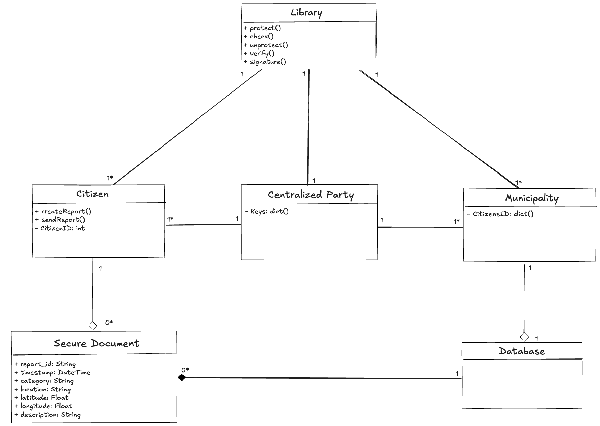
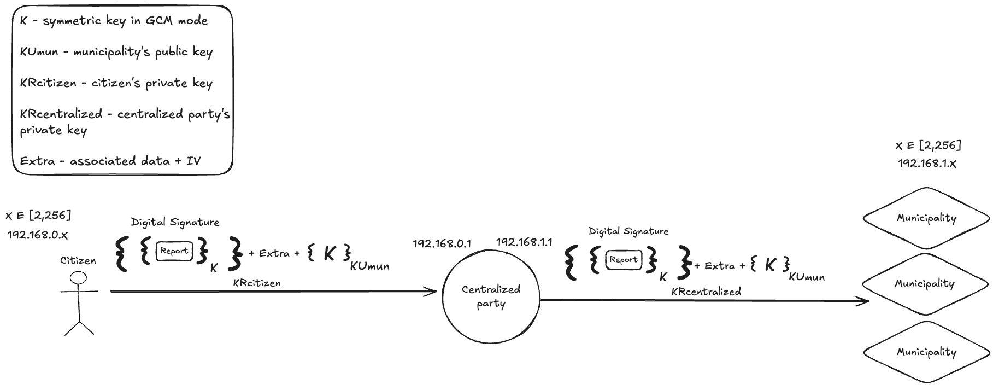

# A03 CivicEcho Project Report

## 1. Introduction
`CivicEcho` is a secure citizen reporting system designed to enable anonymous civic participation while maintaining report authenticity and integrity. 

The system operates in a distributed network environment with three main entities: Citizens who generate reports, Municipalities that process and act upon these reports, and a Centralized Party that serves as a trusted intermediary for authentication and anonymization. Citizens connect from the 192.168.0.0 subnet, while municipalities operate from the 192.168.1.0 subnet, with the centralized party facilitating secure communication between them.

The core architecture implements a hybrid cryptographic approach combining symmetric encryption (AES-GCM) for efficient data protection, asymmetric encryption (RSA) for secure key exchange, and digital signatures for authentication. The secure document format encapsulates citizen reports with multiple layers of protection: confidentiality through hybrid encryption, integrity and freshness through GCM authentication tags, and authenticity through a two-phase digital signature process that preserves anonymity.





## 2. Project Development

### 2.1. Secure Document Format

#### 2.1.1. Design

Our cryptographic library secures citizen-generated reports in JSON format through four primary commands: protect, unprotect, check and authenticate + resign.

To ensure confidentiality, integrity, and authenticity, before a report enters the network, the citizen must first protect it. 
We employ a hybrid encryption scheme to achieve this efficiently. Since asymmetric encryption is inefficient for large messages, the process begins with the citizen generating a unique symmetric key for AES in `Galois Counter Mode (GCM)`. This key encrypts the report itself. The symmetric key is then encrypted using the public key of the intended municipality, ensuring that only the municipality with the corresponding private key can access it, thus guaranteeing confidentiality.

The GCM mode inherently provides integrity and freshness. Any tampering with the ciphertext, even a single bit, results in a completely different authentication tag, which the municipality can detect during decryption, causing the message to be rejected. 
To ensure report authenticity without compromising anonymity, we use a digital signature process with two signatures.

After protecting the report, the citizen signs it with their private key. The centralized party then verifies this signature against a registry of validated citizen public keys, confirming the report originated from a legitimate source without decrypting its contents.

Finally, to anonymize the report for the municipality, the centralized party removes the citizen's signature and signs the protected report with its own private key. The municipality can verify the centralized party's signature, trusting the report's legitimacy while remaining unaware of its specific author. This prevents attackers from submitting fake reports while preserving citizen privacy.

To facilitate the process we have the following assumptions:
1. The public keys from the municipalities and centralized party are well known and verified.
2. All the citizens already have an ID attributed to them.
3. The municipalities have all the valid citizen ID’s 
4. Citizens must be able to query all reports from their municipality


The secure document format uses a JSON structure encoded in Base64:
``` 
  {
    "ciphered": "base64_encrypted_content",
    "iv": "base64_initialization_vector",
    "aad": {
      "timestamp": "report_timestamp",
      "location": "report_location"
    },
    "key": "base64_rsa_encrypted_aes_key",
    "signature": "base64_digital_signature"
  }
```

#### 2.1.2. Implementation
The ProtectDocumentLibrary class provides four main operations:
  
- protect(): Encrypts and signs citizen reports with a citizen's private key.
- unprotect(): Decrypts reports and verifies centralized party signature.
- check(): Verifies report integrity. 
- authenticateAndReSign(): Handles centralized party authentication and anonymization re-signing.

Supporting utility classes include RSAKeyGenerator for asymmetric key management and AESKeyGenerator for symmetric key operations.
***
**Hybrid Encryption Scheme:** 

The encryptGCM() method implements the hybrid encryption approach. Reports are encrypted using AES-256 in Galois Counter Mode with a randomly generated 128-bit symmetric key. The symmetric key is then encrypted using RSA with PKCS1 padding using the municipality's public key.
***
**Integrity and Freshness:** 

GCM mode provides built-in integrity verification through a 128-bit authentication tag. The implementation uses Additional Authenticated Data (AAD) containing the report's timestamp and location metadata, ensuring these critical fields cannot be modified without detection. This is verified utilizing the check() method, which uses GCM to decrypt the ciphered message and guarantee that it was not tampered with. 
***
**Anonymity of Reports:**

The system implements SHA-256 with RSA signatures for authentication and the process consists of these three distinct phases:

1. Citizen Signing: Citizens sign the encrypted ciphertext using their private keys during the protect() operation
2. Centralized Party Re-signing: The authenticateAndReSign() method verifies the citizen's signature against their public key, then replaces it with the centralized party's signature for anonymization.
3. Municipality Verification: The unprotect() method includes signature verification, ensuring municipalities can verify the centralized party's signature before processing reports, thus confirming the report's authenticity while maintaining citizen anonymity.
***
**Libraries used:**

The library was implemented using Java with the standard JCA/JCE cryptographic framework which are well-established, widely tested, and industry-recognized cryptographic libraries.
Key classes come from:
java.security for public/private keys, SecureRandom, and Signature (digital signatures).
javax.crypto for Cipher and GCMParameterSpec (AES-GCM authenticated encryption).
SecretKeySpec for wrapping raw key bytes into a usable AES key.
***

### 2.2. Infrastructure

#### 2.2.1. Network and Machine Setup

(_Provide a brief description of the built infrastructure._)

(_Justify the choice of technologies for each server._)

#### 2.2.2. Server Communication Security

(_Discuss how server communications were secured, including the secure channel solutions implemented and any challenges encountered._)

(_Explain what keys exist at the start and how are they distributed?_)

### 2.3. Security Challenge

#### 2.3.1. Challenge Overview

(_Describe the new requirements introduced in the security challenge and how they impacted your original design._)

#### 2.3.2. Attacker Model

(_Define who is fully trusted, partially trusted, or untrusted._)

(_Define how powerful the attacker is, with capabilities and limitations, i.e., what can he do and what he cannot do_)

#### 2.3.3. Solution Design and Implementation

(_Explain how your team redesigned and extended the solution to meet the security challenge, including key distribution and other security measures._)

(_Identify communication entities and the messages they exchange with a UML sequence or collaboration diagram._)  

## 3. Conclusion

(_State the main achievements of your work._)

(_Describe which requirements were satisfied, partially satisfied, or not satisfied; with a brief justification for each one._)

(_Identify possible enhancements in the future._)

(_Offer a concluding statement, emphasizing the value of the project experience._)

## 4. Bibliography

(_Present bibliographic references, with clickable links. Always include at least the authors, title, "where published", and year._)

----
END OF REPORT
